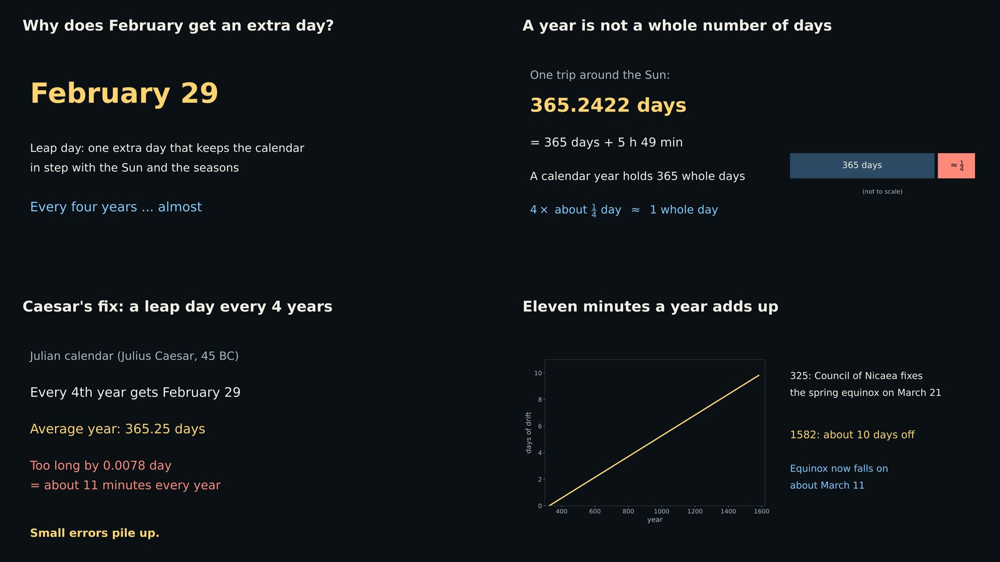
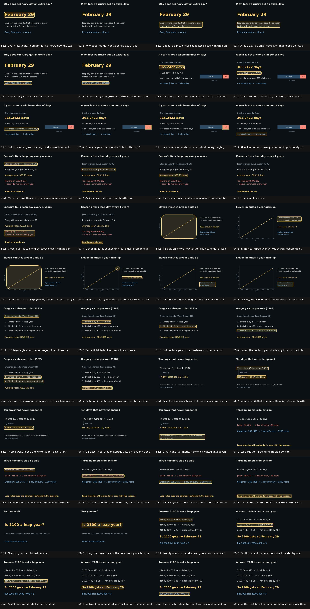

# Read Aloud Lessons

Turn notes (or a topic) into a narrated lesson video: code-drawn chalkboard slides, a marker that
appears on whatever each sentence is talking about, an offline voice with exact sentence timing,
and checks that catch wrong facts and unclear narration before you ever press play.



It is the video companion to [Read Aloud](https://github.com/steveonw/Read-Aloud-Main): Read Aloud
exports audio plus the start and end of every sentence, and those timestamps drive every video here.

## How it works

```
notes -> script + boards (drawn with code) -> plan.json -> narration + timestamps -> checks -> MP4
```

- **Boards are drawn with code** (matplotlib), so every equation, number and label is exact.
  The `Board` helper records where each named item lands, so markers come from the drawing itself.
- **Markers, not camera moves.** The view holds still; a box, underline or ring marks what each
  sentence names, fading in when that sentence starts speaking.
- **Audio drives timing.** One WAV plus sentence timestamps (Audacity labels, SRT, VTT or JSON):
  from Read Aloud, from `tools/narrate.py`, or from any TTS that exports them.
- **Checks before delivery.** A plan linter, a per-video fact checker (`validate.py`), a contact
  sheet with one thumbnail per sentence, and a listen-free audio check that runs speech
  recognition over every sentence.

Every sentence of the leap-year example and the mark it gets
([full contact sheet](docs/leap-years-contact-sheet.jpg)):



## Quick start

```bash
pip install -r requirements.txt          # plus ffmpeg from your package manager
python examples/smoke-test/run.py        # ~10 s, no voice needed: proves everything works

cd examples/leap-years
python build.py                          # draws the boards, writes plan.json
python validate.py                       # 16 fact checks
python ../../tools/render_video.py plan.json --check          # plan lint
python ../../tools/render_video.py plan.json --contact-sheet  # every sentence + its mark
python ../../tools/render_video.py plan.json --preview        # silent draft with estimated timing
```

Narration and the final video:

```bash
pip install -r requirements-voice.txt
python ../../tools/narrate.py plan.json --model-dir <Kokoro voice folder>    # narration.wav + labels.txt
python ../../tools/check_audio.py plan.json --asr-dir <speech recognizer folder>
python ../../tools/render_video.py plan.json                                  # final.mp4
```

Or read `tts/narration_all.txt` (from `--export-tts tts`) in Read Aloud, export the WAV with its
label track, point `plan.json` at them, and render.

## Voices and models (not included)

| What | Get it from | Size |
|---|---|---|
| Kokoro v1.0 (best voice, 54 speakers) | Hugging Face `onnx-community/Kokoro-82M-v1.0-ONNX`, or the `voices/kokoro-gpu-v1-0` folder of Read Aloud | ~330 MB |
| Kitten micro 0.8 (fast drafts) | Hugging Face `tecmage/kitten-micro-en-v0_8` | ~63 MB |
| Piper Amy | sherpa-onnx GitHub release `tts-models` | ~60 MB |
| Speech recognizer for `check_audio.py` | sherpa-onnx release `asr-models`, `sherpa-onnx-zipformer-small-en-2023-06-26` | ~100 MB |

Several voices (dialogue, characters) work too: add a `"cast"` and a `"speaker"` per line in
`plan.json`; voices are level-matched and British voices get British pronunciation.

## Motion comics (stories with characters)

For a story rather than a lesson (a sketch, a parody ad, a short drama) with painted or
image-generated panels, `tools/motion_comic.py` makes a motion comic: every shot moves, cuts
and effects (shakes, flashes, debris, falling props) land on spoken **words**, characters get
their own voices and pitch, and a music bed and sound effects are mixed to about -14 LUFS.
Everything is anchored to lines and words, never to seconds, so new narration re-times the whole
edit. The workflow is `skill/motion-comic-video/SKILL.md`.

```bash
python examples/motion-comic-smoke/run.py      # a few seconds, no voice or art needed
```

## Repository

| Path | What |
|---|---|
| `tools/render_video.py` | boards + plan + audio/timestamps -> MP4 with chapters and switchable subtitles; `--check`, `--contact-sheet`, `--preview`, `--clip`, `--export-tts` |
| `tools/narrate.py` | local narration (Kokoro, Kitten, Piper) with exact sentence labels, multi-voice cast, sentence cache |
| `tools/check_audio.py` | listen-free audio check against the plan: stale narration, misheard words, silence, clipping, pauses, quiz think time, per-speaker pitch |
| `tools/board.py` | the `Board` drawing helper for single boards and 2x2 panel pages |
| `tools/motion_comic.py` | motion comic renderer: shots with camera moves, word-anchored cuts/effects/sounds, cards, lower thirds, music, -14 LUFS mix; `--check`, `--contact-sheet`, `--clip` |
| `tools/voice_fx.py` | per-character pitch/echo and tight pauses (trims TTS padding, rewrites exact labels) |
| `tools/word_times.py` | word start times for every line from the speech recognizer, for word anchors |
| `tools/upscale.py` | 4x Real-ESRGAN upscale of small painted panels (CPU) |
| `skill/SKILL.md` | the full workflow (planning, writing, drawing, checking, timing, rendering) as an AI skill |
| `skill/motion-comic-video/SKILL.md` | the motion comic workflow as a separate AI skill |
| `examples/smoke-test` | 10-second toolchain check |
| `examples/sky-blue` | why the sky is blue: 8 single boards, about 5 minutes, 15 physics checks |
| `examples/leap-years` | why leap years exist: 2x2 panel pages, three voices, a quiz, 16 checks |
| `examples/motion-comic-smoke` | motion comic toolchain check: code-drawn panels, stand-in narration, every effect |
| `examples/zorblooks` | a 3-minute parody ad plan: 7 voices, 61 shots, word-timed gags (art not included) |

## Using it with an AI

Give the AI `skill/SKILL.md` (lessons) or `skill/motion-comic-video/SKILL.md` (stories). With Claude it can be added as a skill; it clones this repo for the
tools, so no code is pasted into the conversation. Any AI with Python and ffmpeg can follow it.

## Credits

Kokoro-82M by hexgrad, Kitten TTS by KittenML, Piper voices, and sherpa-onnx by k2-fsa, each under
its own license. Built with Claude.

MIT License. See [LICENSE](LICENSE).
